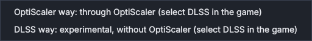
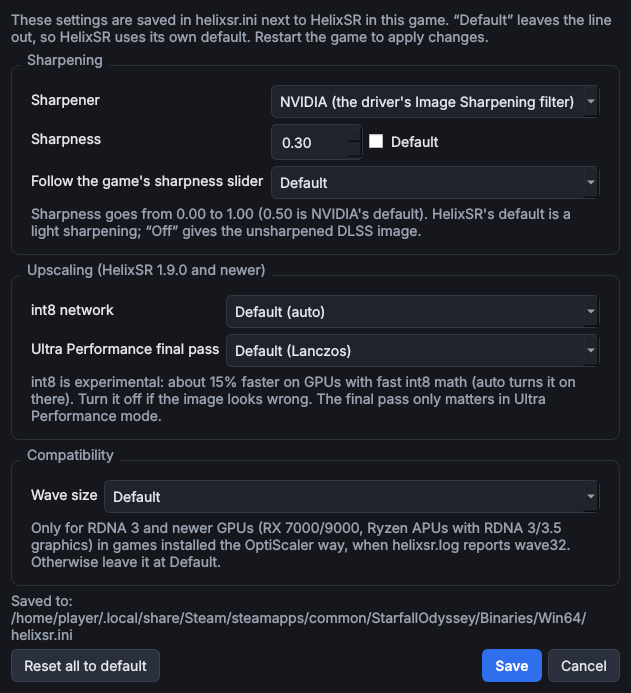
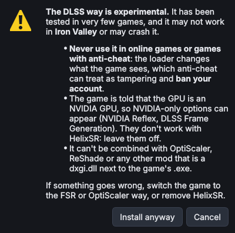
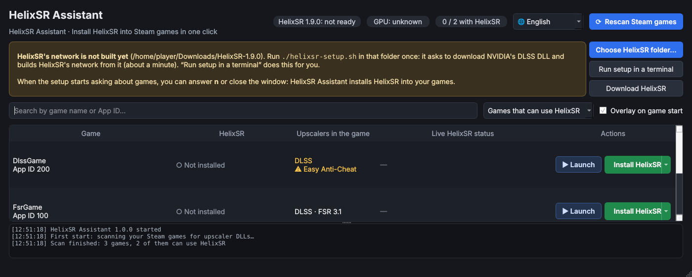

# HelixSR Assistant (HelixSR 助手)

**English** · [台灣正體中文](#台灣正體中文)

---

## English

A desktop tool (PyQt6) that installs, switches, updates and removes [HelixSR](https://github.com/lonewolf0622/HelixSR) in your Steam games with one click, and shows whether HelixSR is actually running when you play. For Linux desktops, laptops and the Steam Deck's Desktop Mode.

HelixSR runs NVIDIA's DLSS Model E upscaling network on AMD GPUs (RDNA 1 and newer) through Proton. It has no launch options or central settings: it is installed by putting DLLs into each game's folder, one of three ways per game. HelixSR Assistant does that for you, keeps everything it replaces, and puts it all back on removal.

> ⚠ **HelixSR Assistant does not include HelixSR.** Download HelixSR 1.8.0 or newer from its [releases](https://github.com/lonewolf0622/HelixSR/releases) and run `./helixsr-setup.sh` in its folder once (this builds HelixSR's network on your PC) before using it.

**Download**: the AppImage is on the [Releases](https://github.com/mosesmoon/helixsr-assistant/releases) page.

**Full feature guide** (12 languages): [English](docs/features/en.md) · [台灣正體中文](docs/features/zh_TW.md) · [简体中文](docs/features/zh_CN.md) · [日本語](docs/features/ja.md) · [Deutsch](docs/features/de.md) · [Français](docs/features/fr.md) · [Español](docs/features/es.md) · [Italiano](docs/features/it.md) · [ไทย](docs/features/th.md) · [Tiếng Việt](docs/features/vi.md) · [Bahasa Melayu](docs/features/ms.md) · [हिन्दी](docs/features/hi.md)

### Screenshots


| | |
|---|---|
| <br>Pick another way from the Install button's arrow | <br>HelixSR settings (helixsr.ini) as a form |
| <br>The experimental DLSS way explains its risks first | <br>Guidance until HelixSR's network is built |

The games in these screenshots are made up.

### Changelog

Multilingual release notes for each version are in [`docs/releases/`](docs/releases/). The build attaches them next to the AppImage (`dist/HelixSR_Assistant-<version>-README.md`).

| Version | Date | Summary |
|---|---|---|
| [1.0.0](docs/releases/1.0.0.md) | 2026-10-14 | First release |

### Features

- **Scans Steam games and their upscalers**: finds the FSR 3.1, DLSS, XeSS and FSR 2 DLLs in every game, the folder of its main `.exe`, and whether it has anti-cheat. Lists which of HelixSR's ways work for each game.
- **One-click install** of the three ways HelixSR offers, the default first:

  | Way | The game needs | What changes | Select in the game |
  |---|---|---|---|
  | FSR way (f) | FSR 3.1 | The game's FSR 3.1 DLL is replaced by HelixSR (kept as `*.original.dll`) | AMD FSR |
  | OptiScaler way (o) | DLSS, XeSS or FSR 2 | OptiScaler next to the `.exe`, pointed at a `HelixSR` folder; replaced files go to `HelixSR/backup` | DLSS |
  | DLSS way (d, experimental) | DLSS | HelixSR's DLSS loader (`dxgi.dll`) and HelixSR as `nvngx.dll` next to the `.exe` | DLSS |

- **Switch, update, repair, remove**: switch ways (settings move along), update games to the build in your HelixSR folder ("Update all"), repair games after a game update or "Verify integrity" put the game's files back, and remove with every file restored.
- **HelixSR settings as a form**: sharpening, int8 network, Ultra Performance final pass and wave size in each game's `helixsr.ini`; other lines and comments are kept.
- **Live HelixSR status**: running games are checked every 3 seconds; `/proc/<pid>/maps` shows whether HelixSR (and OptiScaler or the DLSS loader) is really loaded, and `helixsr.log` from the current run shows the wave size and errors. On RDNA 3 and newer with the OptiScaler way, "Set WaveSize = 64" is offered when the log says wave32.
- **Overlay on game start**: a card in the bottom-right corner when HelixSR loads (or a hint if it has not loaded after 90 seconds). Separate X11 window, never takes focus, can be turned off.
- **Safe by design**: nothing changes unless the HelixSR folder is set up and the game is closed; the DLSS way and games with anti-cheat need confirmation; every copy is verified byte for byte.
- **Works with HelixSR's own setup**: the same install record (`helixsr-install.json`), backups and file names, so `helixsr-setup.sh` / `helixsr-uninstall.sh` and HelixSR Assistant recognise each other's games.
- **Languages**: 台灣正體中文, 简体中文, English, 日本語, Deutsch, Français, Español, Italiano, ไทย, Tiếng Việt, Bahasa Melayu, हिन्दी.

### Install and run

**AppImage (recommended)**: Python and Qt are included, so nothing else needs to be installed.

1. Download `HelixSR_Assistant-<version>-x86_64.AppImage` from the [Releases](https://github.com/mosesmoon/helixsr-assistant/releases) page.
2. Make it executable: right-click the file → Properties → Permissions, and turn on "Allow executing file as program" (the wording varies by file manager).
3. Double-click it to open HelixSR Assistant.

Or in a terminal:

```bash
chmod +x HelixSR_Assistant-*-x86_64.AppImage
./HelixSR_Assistant-*-x86_64.AppImage
```

**From source**: Python 3.11+ and PyQt6 (Arch: `sudo pacman -S python-pyqt6`).

```bash
./install.sh           # install to ~/.local/share/helixsr-assistant and add a menu entry
helixsr-assistant      # or run ./helixsr-assistant from the source folder
```

### Development

```bash
python3 -m unittest discover -s . -p "test_*.py" -v   # tests (no PyQt6 needed)
./build-appimage.sh                                    # dist/HelixSR_Assistant-<version>-x86_64.AppImage
```

The AppImage bundles a portable CPython 3.13 (uv / python-build-standalone) and a trimmed PyQt6. Building needs `uv` and network access (PyQt6 wheels and appimagetool).

HelixSR Assistant's own state is in `~/.config/helixsr-assistant/state.json`.

### Licences

HelixSR Assistant is an independent, unofficial tool, not affiliated with or endorsed by HelixSR's author, NVIDIA, AMD or the OptiScaler project, and it contains none of their files. Its installer is its own code following the manual steps HelixSR's README documents. HelixSR is free to use under the HelixSR Freeware License. After HelixSR's setup, HelixSR's DLLs contain NVIDIA's network: HelixSR Assistant only copies them between folders on your own PC. Never share or upload them.

---

## 台灣正體中文

一套桌面工具（PyQt6），能一鍵為 Steam 遊戲安裝、切換、更新或移除 [HelixSR](https://github.com/lonewolf0622/HelixSR)，並在你玩遊戲時顯示 HelixSR 是否真的在運作。適用於一般 Linux 桌機、筆電，以及 Steam Deck 的桌面模式。

HelixSR 透過 Proton，把 NVIDIA DLSS Model E 的升頻神經網路跑在 AMD 顯示卡（RDNA 1 以上）上。它沒有啟動選項，也沒有集中的設定檔：安裝方式是把 DLL 放進每款遊戲的資料夾，每款遊戲有三種方式可選。HelixSR 助手替你完成這些步驟，保留所有被取代的檔案，移除時全部放回原處。

> ⚠ **HelixSR 助手不包含 HelixSR。** 使用前請先從 [HelixSR 的 Releases](https://github.com/lonewolf0622/HelixSR/releases) 下載 HelixSR 1.8.0 以上，並在它的資料夾執行一次 `./helixsr-setup.sh`（這會在你的電腦上建立 HelixSR 的神經網路）。

**下載**：AppImage 放在 [Releases](https://github.com/mosesmoon/helixsr-assistant/releases) 頁面。

**完整功能介紹**（12 種語言）：[English](docs/features/en.md) · [台灣正體中文](docs/features/zh_TW.md) · [简体中文](docs/features/zh_CN.md) · [日本語](docs/features/ja.md) · [Deutsch](docs/features/de.md) · [Français](docs/features/fr.md) · [Español](docs/features/es.md) · [Italiano](docs/features/it.md) · [ไทย](docs/features/th.md) · [Tiếng Việt](docs/features/vi.md) · [Bahasa Melayu](docs/features/ms.md) · [हिन्दी](docs/features/hi.md)

### 截圖


| | |
|---|---|
| <br>從「安裝 HelixSR」按鈕的箭頭選擇其他方式 | <br>以表單編輯 HelixSR 設定（helixsr.ini） |
| <br>實驗性的 DLSS 方式會先說明風險 | <br>HelixSR 網路建立前的引導說明 |

截圖中的遊戲都是虛構的。

### 更新紀錄

各版本的多語系更新說明放在 [`docs/releases/`](docs/releases/)。建置時會附在 AppImage 旁（`dist/HelixSR_Assistant-<版本>-README.md`）。

| 版本 | 日期 | 摘要 |
|---|---|---|
| [1.0.0](docs/releases/1.0.0.md) | 2026-10-14 | 第一版 |

### 功能

- **掃描 Steam 遊戲及其升頻技術**：在每款遊戲中找出 FSR 3.1、DLSS、XeSS 和 FSR 2 的 DLL、主要 `.exe` 所在資料夾，以及是否含有反作弊。列出每款遊戲可用的 HelixSR 安裝方式。
- **一鍵安裝** HelixSR 提供的三種方式，預設方式排第一：

  | 方式 | 遊戲需要具備 | 變更內容 | 遊戲內選擇 |
  |---|---|---|---|
  | FSR 方式（f） | FSR 3.1 | 遊戲的 FSR 3.1 DLL 被 HelixSR 取代（原檔保留為 `*.original.dll`） | AMD FSR |
  | OptiScaler 方式（o） | DLSS、XeSS 或 FSR 2 | 在 `.exe` 旁放入 OptiScaler，指向 `HelixSR` 資料夾；被取代的檔案移到 `HelixSR/backup` | DLSS |
  | DLSS 方式（d，實驗性） | DLSS | 在 `.exe` 旁放入 HelixSR 的 DLSS 載入器（`dxgi.dll`）及以 `nvngx.dll` 為名的 HelixSR | DLSS |

- **切換、更新、修復、移除**：切換方式（設定一併帶過去）、把遊戲更新到 HelixSR 資料夾中的版本（「全部更新」）、在遊戲更新或「驗證遊戲檔案」把遊戲原檔放回後修復，移除時所有檔案恢復原狀。
- **以表單調整 HelixSR 設定**：每款遊戲 `helixsr.ini` 中的銳利化、int8 網路、超高效能模式的最後縮放和 wave 大小；檔案中的其他設定和註解都會保留。
- **HelixSR 即時狀態**：每 3 秒檢查執行中的遊戲；從 `/proc/<pid>/maps` 確認 HelixSR（以及 OptiScaler 或 DLSS 載入器）是否真的載入，並從本次執行的 `helixsr.log` 顯示 wave 大小和錯誤。RDNA 3 以上顯示卡使用 OptiScaler 方式時，若記錄顯示 wave32，會提供「設定 WaveSize = 64」。
- **遊戲啟動時的浮動提示**：HelixSR 載入時在右下角顯示小卡片（90 秒後仍未載入則提示要選什麼）。獨立的 X11 視窗，不會搶焦點，可關閉。
- **以安全為設計原則**：HelixSR 資料夾尚未設定好或遊戲正在執行時不做任何變更；DLSS 方式和含反作弊的遊戲需要確認；每次複製都逐位元組比對。
- **與 HelixSR 本身的 setup 互通**：使用相同的安裝紀錄（`helixsr-install.json`）、備份和檔名，`helixsr-setup.sh`／`helixsr-uninstall.sh` 與 HelixSR 助手都認得對方安裝的遊戲。
- **語言**：台灣正體中文、简体中文、English、日本語、Deutsch、Français、Español、Italiano、ไทย、Tiếng Việt、Bahasa Melayu、हिन्दी。

### 安裝與執行

**AppImage（建議）**：已內含 Python 和 Qt，不需要另外安裝任何東西。

1. 從 [Releases](https://github.com/mosesmoon/helixsr-assistant/releases) 頁面下載 `HelixSR_Assistant-<版本>-x86_64.AppImage`。
2. 設定為可執行：對檔案按右鍵 →「內容」→「權限」，勾選「允許以程式執行檔案」（各檔案管理員的用詞略有不同）。
3. 按兩下即可開啟 HelixSR 助手。

或在終端機執行：

```bash
chmod +x HelixSR_Assistant-*-x86_64.AppImage
./HelixSR_Assistant-*-x86_64.AppImage
```

**從原始碼執行**：需要 Python 3.11 以上和 PyQt6（Arch：`sudo pacman -S python-pyqt6`）。

```bash
./install.sh           # 安裝到 ~/.local/share/helixsr-assistant，並建立選單項目
helixsr-assistant      # 或直接在原始碼目錄執行 ./helixsr-assistant
```

### 開發

```bash
python3 -m unittest discover -s . -p "test_*.py" -v   # 測試（不需要 PyQt6）
./build-appimage.sh                                    # 輸出 dist/HelixSR_Assistant-<版本>-x86_64.AppImage
```

AppImage 內含可攜式 CPython 3.13（uv / python-build-standalone）與精簡過的 PyQt6。建置需要 `uv` 與網路（下載 PyQt6 wheel 與 appimagetool）。

HelixSR 助手本身的狀態存在 `~/.config/helixsr-assistant/state.json`。

### 授權

HelixSR 助手是獨立的非官方工具，與 HelixSR 作者、NVIDIA、AMD 或 OptiScaler 專案沒有關聯，也未經其認可，且不含它們的任何檔案。它的安裝程式是自行撰寫的程式碼，依照 HelixSR README 記載的手動安裝步驟運作。HelixSR 依 HelixSR Freeware License 免費使用。HelixSR 的 setup 執行後，HelixSR 的 DLL 會包含 NVIDIA 的神經網路：HelixSR 助手只會在你自己電腦上的資料夾之間複製它們。請勿分享或上傳這些檔案。
