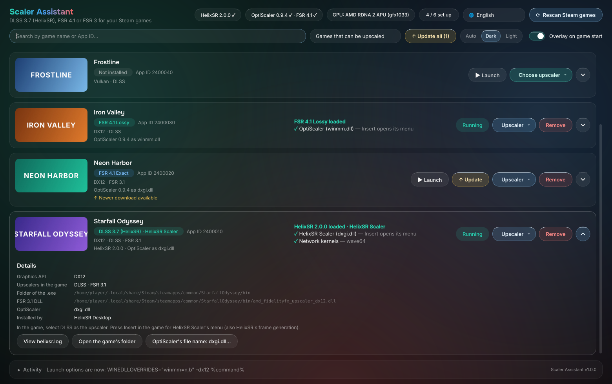
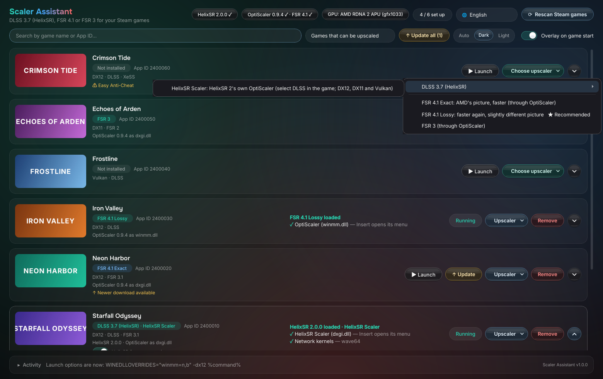
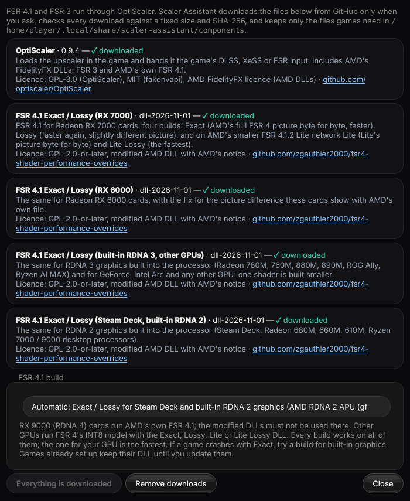
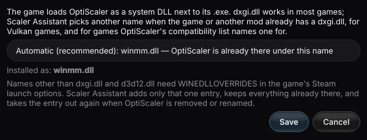
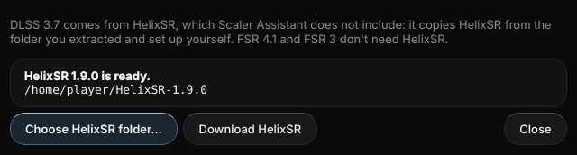
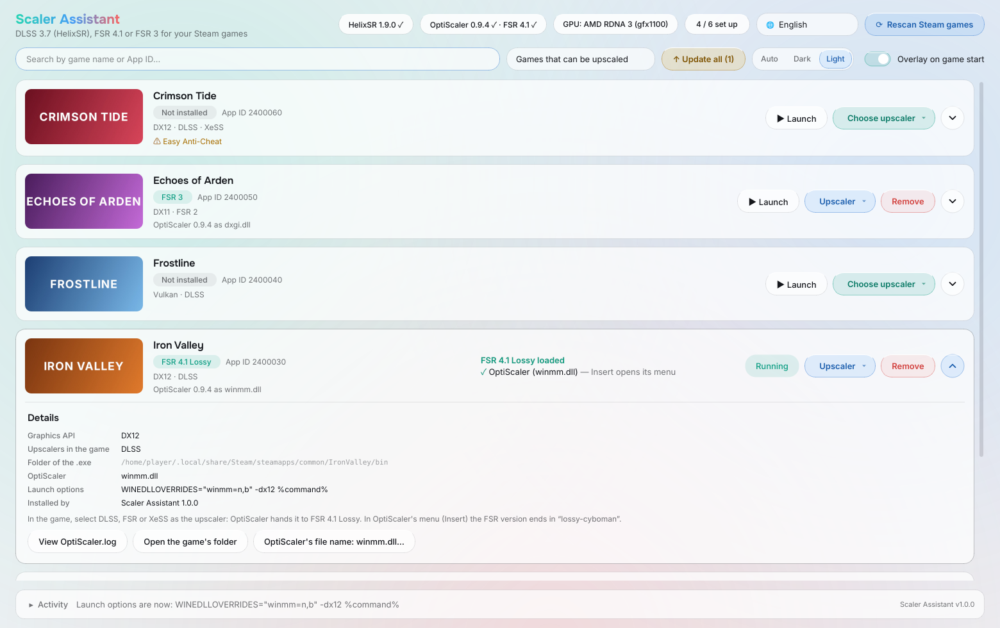

# Scaler Assistant (Scaler 助手)

**English** · [台灣正體中文](#台灣正體中文)

---

## English

A desktop tool (PyQt6) that lets you choose the upscaler for each Steam game — **DLSS 3.7 ([HelixSR](https://github.com/lonewolf0622/HelixSR))**, **FSR 4.1 Exact / Lossy** ([fsr4-shader-performance-overrides](https://github.com/zgauthier2000/fsr4-shader-performance-overrides); AMD's own FSR 4.1 on RX 9000) or **FSR 3** — and installs, switches, updates, repairs and removes it with one click. It detects each game's graphics API and upscalers, picks a file name for OptiScaler that works in the game, sets OptiScaler.ini for your choice and adds the Steam launch option when one is needed, without touching anything else in your launch options. For Linux desktops, laptops and the Steam Deck's Desktop Mode, and as a **Steam Deck plugin for [Decky Loader](https://decky.xyz)** that does the same from the Quick Access menu in Game Mode. Formerly HelixSR Assistant.

> ⚠ **Scaler Assistant contains no upscaler files.** FSR 4.1 and FSR 3 run through OptiScaler, which it downloads (with the FSR 4.1 DLLs for your GPU) only when you agree. For DLSS 3.7, download HelixSR 1.8.0 or newer from its [releases](https://github.com/lonewolf0622/HelixSR/releases) and run `./helixsr-setup.sh` in its folder once — or, for HelixSR 2.0 and newer, just press **Download and build HelixSR** in Scaler Assistant.

**Download**: the AppImage, the single installer (`.bin`), the Flatpak bundle and the Decky plugin (`Scaler_Assistant-Decky-<version>.zip`) are on the [Releases](https://github.com/mosesmoon/scaler-assistant/releases) page.

**Full feature guide** (12 languages): [English](docs/features/en.md) · [台灣正體中文](docs/features/zh_TW.md) · [简体中文](docs/features/zh_CN.md) · [日本語](docs/features/ja.md) · [Deutsch](docs/features/de.md) · [Français](docs/features/fr.md) · [Español](docs/features/es.md) · [Italiano](docs/features/it.md) · [ไทย](docs/features/th.md) · [Tiếng Việt](docs/features/vi.md) · [Bahasa Melayu](docs/features/ms.md) · [हिन्दी](docs/features/hi.md)

### Screenshots



| | |
|---|---|
| <br>The upscaler menu on a Steam Deck with HelixSR 2.0: HelixSR Scaler, and FSR 4.1 Lossy recommended | <br>OptiScaler and FSR 4.1 downloads and the FSR 4.1 build for your GPU |
| <br>OptiScaler's file name, chosen automatically or by hand | <br>The HelixSR folder for DLSS 3.7 |
| <br>The light theme (Auto follows the desktop) | |

The games in these screenshots are made up.

### Changelog

Multilingual release notes for each version are in [`docs/releases/`](docs/releases/). The build attaches them next to the AppImage (`dist/Scaler_Assistant-<version>-README.md`).

| Version | Date | Summary |
|---|---|---|
| [1.0.1](docs/releases/1.0.1.md) | 2026-10-25 | FSR 4.1 DLLs of dll-2026-10-22: four builds (RX 7000, RX 6000, built-in RDNA 3 and other GPUs, Steam Deck and built-in RDNA 2); new FSR 4.1 Lossy2 |
| [1.0.0](docs/releases/1.0.0.md) | 2026-10-19 | First release: DLSS 3.7 (HelixSR), FSR 4.1 Exact / Lossy, FSR 3; Liquid Glass window; Decky plugin for the Steam Deck |

### Features

- **One menu per game**: DLSS 3.7 (HelixSR: FSR way, OptiScaler way, experimental DLSS way), FSR 4.1 Exact, FSR 4.1 Lossy, FSR 4.1 Lossy2 (FSR 4.1 by AMD on RX 9000), FSR 3, or remove. Only what works for the game is offered.

  | Choice | The game needs | In the game, select |
  |---|---|---|
  | DLSS 3.7 (HelixSR) | Direct3D 12 with FSR 3.1, DLSS, XeSS or FSR 2 | AMD FSR (FSR way) or DLSS |
  | FSR 4.1 Exact / Lossy / Lossy2 / AMD | DLSS, XeSS, FSR 2 or FSR 3.1 (DX12; DX11 and Vulkan through OptiScaler's DX12 path) | DLSS, FSR or XeSS |
  | FSR 3 | DLSS, XeSS, FSR 2 or FSR 3.1 (DX12, DX11, Vulkan) | DLSS, FSR or XeSS |

- **Download and build HelixSR in one step**: "Download and build HelixSR" (in the HelixSR window and in the Steam Deck plugin) downloads the newest HelixSR (2.0 or newer) from its GitHub releases, checked by SHA-256, into `~/.local/share/scaler-assistant/helixsr`, and builds it on this PC with HelixSR's own build program (`setup/helixsr_setup.py`, run as is) — the way HelixSR's own app does it, so no terminal and no games step. It brings what the build needs: a Python with numpy (a portable Python 3.14 when the system's can't unpack NVIDIA's zstd package, so frame generation needs no extra `zstd` program) and Microsoft's DirectX Shader Compiler, run through Steam's Proton or Wine. NVIDIA's files are downloaded only after you agree in the app; what is built stays on your PC. Inside Flatpak the build runs on the host. Running it again only builds what is missing; a newer release replaces the one downloaded before.
- **HelixSR 2.0**: HelixSR Scaler (select DLSS in the game; also DX11 and Vulkan) and the FSR way, installed through the installer inside your HelixSR folder, so HelixSR's own setup and app recognise the games and the other way round. HelixSR 1.8.x keeps its three ways; 1.9.0 – 1.9.3 only carry the FSR way's files, so the other ways are greyed out there.
- **HelixSR frame generation** (HelixSR 2.0): in DirectX 12 games that have DLSS Frame Generation (Streamline's `sl.dlss_g.dll`), a game with HelixSR Scaler gets a "HelixSR frame generation" switch on its card (and in the Steam Deck plugin). It runs HelixSR's own installer (`scaler-fg`), which only changes OptiScaler.ini's `[FrameGen]` choice; then turn on DLSS Frame Generation in the game. It needs the frame generation that `./helixsr-setup.sh` builds (it downloads NVIDIA's DLSS Frame Generation files); until then the switch is greyed out with the reason. New installs leave it off; an update or a new OptiScaler file name keeps it as it was. Other DX12 games can still pick AMD FSR or XeSS frame generation in HelixSR Scaler's menu (Insert); DX11 / Vulkan games and the FSR way get upscaling only.
- **Choices that fit your GPU**: the DLSS way is greyed out without a GeForce (AMD and Intel GPUs can't select DLSS in games); on built-in graphics (Steam Deck, ROG Ally Z1 / Z2, Ryzen AI MAX) and Intel GPUs, FSR 4.1 Lossy is marked "★ Recommended" among the FSR 4.1 choices.
- **Detects each game**: upscaler DLLs, the main `.exe` folder, the graphics API (from the `.exe`'s imports) and anti-cheat.
- **OptiScaler's file name** picked for the game: your choice, an existing OptiScaler, OptiScaler's compatibility list, `winmm.dll` for Vulkan, a free name when `dxgi.dll` is taken (game, ReShade or your launch options), else `dxgi.dll`. Files already there go to a backup folder.
- **Launch options left intact**: names other than `dxgi.dll` / `d3d12.dll` need `WINEDLLOVERRIDES`; only that one entry is inserted (inside your existing `WINEDLLOVERRIDES` if you have one) and later only that entry is taken out. Written live through Steam when possible, otherwise Steam is closed and restarted first (with your confirmation).
- **Downloads on request**: OptiScaler 0.9.4 and FSR 4.1 Exact / Lossy / Lossy2 in the build for your GPU (RX 7000, RX 6000, built-in RDNA 3 and other GPUs, or Steam Deck and built-in RDNA 2), pinned releases checked by SHA-256. RDNA 4 uses AMD's own FSR 4.1; other GPUs get FSR 4's INT8 model. FSR 4.1 Lossy and Lossy2 each show their `WARNING.txt` first.
- **OptiScaler.ini** edited section by section: only the upscaler keys, `UpscalerIndex`, `Fsr4Update`, `Fsr4ForceEnableInt8` and the FidelityFX DLL paths change.
- **Switch, update, repair, remove**: switching removes the current choice first; "Update all" brings games to your HelixSR build and the current downloads; "Repair" fixes games after a game update (and a missing launch option); removal puts every file back.
- **HelixSR settings** (`helixsr.ini`) as a form, **live status** of what is really loaded in a running game, and an **overlay** when a game starts.
- **Works with HelixSR's own setup**: same install record (`helixsr-install.json`) and backups for DLSS 3.7.
- **Liquid Glass look** (after MAKO Assistant): a card per game with its cover, status and a details panel; raised clear-crystal buttons (highlight, rim glint and soft shadow, no gradients); dark, light or automatic theme.
- **Steam Deck plugin (Decky Loader)**: the same choices, downloads, OptiScaler name and launch-option handling from the Quick Access menu in Game Mode, with a notification when a game starts. It shares settings and downloads with the desktop app. HelixSR's own `helixsr.ini` settings stay in the desktop app.
- **Languages**: 台灣正體中文, 简体中文, English, 日本語, Deutsch, Français, Español, Italiano, ไทย, Tiếng Việt, Bahasa Melayu, हिन्दी.

### Install and run

**AppImage (recommended)**: Python, Qt and 7-Zip are included.

1. Download `Scaler_Assistant-<version>-x86_64.AppImage` from the [Releases](https://github.com/mosesmoon/scaler-assistant/releases) page.
2. Make it executable: right-click the file → Properties → Permissions, and turn on "Allow executing file as program" (the wording varies by file manager).
3. Double-click it.

```bash
chmod +x Scaler_Assistant-*-x86_64.AppImage
./Scaler_Assistant-*-x86_64.AppImage
```

**Steam Deck (Decky Loader)**: install [Decky Loader](https://decky.xyz) first.

1. Download `Scaler_Assistant-Decky-<version>.zip` from the [Releases](https://github.com/mosesmoon/scaler-assistant/releases) page.
2. In Game Mode open the Quick Access menu → Decky → ⚙ → Developer (turn on Developer mode in Decky's General settings first) → "Install Plugin from ZIP File", and pick the zip.
3. Open Scaler Assistant in the Quick Access menu's Decky tab. For DLSS 3.7, press **Download and build HelixSR** in the plugin (or set up HelixSR yourself and choose its folder).

**Single installer (.bin)**: `Scaler_Assistant-<version>-x86_64.bin` installs the same bundled app for your user only (no root, no FUSE) into `~/.local/opt/scaler-assistant`, with the `scaler-assistant` command and a menu entry. **Flatpak**: `Scaler_Assistant-<version>-x86_64.flatpak` is a single-file bundle on the Freedesktop 25.08 runtime (fetched from Flathub on install). It may read your home folder and other drives (SD cards under `/run/media`) and sees Steam's and the games' processes through `flatpak-spawn --host`.

```bash
sh Scaler_Assistant-*-x86_64.bin                # install / install
sh Scaler_Assistant-*-x86_64.bin --uninstall    # remove / remove
flatpak install --user Scaler_Assistant-*-x86_64.flatpak
flatpak run io.github.mosesmoon.ScalerAssistant
```

**From source**: Python 3.11+, PyQt6 (Arch: `sudo pacman -S python-pyqt6`) and 7-Zip or bsdtar to unpack OptiScaler (`sudo pacman -S 7zip`).

```bash
./install.sh           # install to ~/.local/share/scaler-assistant and add a menu entry
scaler-assistant       # or run ./scaler-assistant from the source folder
```

### Development

```bash
python3 -m unittest discover -s tests -t . -v   # tests (no PyQt6 needed)
./build-appimage.sh                              # dist/Scaler_Assistant-<version>-x86_64.AppImage
./build-decky.sh                                 # dist/Scaler_Assistant-Decky-<version>.zip (needs Node.js)
./build-bin.sh                                   # dist/Scaler_Assistant-<version>-x86_64.bin
./build-flatpak.sh                               # dist/Scaler_Assistant-<version>-x86_64.flatpak (needs flatpak)
```

The Decky plugin is in `decky/`: a React panel (`src/index.tsx`, built with `@decky/rollup`) and a Python backend (`main.py`) that runs the same `scaler_assistant` package (its `deck.py` bridge) without the desktop window.

The AppImage bundles a portable CPython 3.13 (uv / python-build-standalone), a trimmed PyQt6 and 7-Zip's static `7zzs` (with its licence). Building needs `uv` and network access.

Scaler Assistant's state is in `~/.config/scaler-assistant/state.json` (taken over once from `~/.config/helixsr-assistant`); downloads are in `~/.local/share/scaler-assistant/components/`.

### Licences

Scaler Assistant is an independent, unofficial tool, not affiliated with or endorsed by HelixSR's author, NVIDIA, AMD, the OptiScaler project or the fsr4-shader-performance-overrides project, and it contains none of their files. On request it downloads OptiScaler (GPL-3.0; fakenvapi MIT; AMD's FidelityFX DLLs under AMD's licence) and the FSR 4.1 DLLs (GPL-2.0-or-later, modified AMD DLLs with AMD's notice) from their GitHub releases. The AppImage and the Decky plugin include 7-Zip's `7zzs` (GNU LGPL with the unRAR restriction, BSD). HelixSR is free to use under the HelixSR Freeware License; after its setup, HelixSR's DLLs contain NVIDIA's network, so Scaler Assistant only copies them between folders on your own PC. Never share or upload them.

---

## 台灣正體中文

一套桌面工具（PyQt6），讓你替每款 Steam 遊戲選擇升頻技術——**DLSS 3.7（[HelixSR](https://github.com/lonewolf0622/HelixSR)）**、**FSR 4.1 Exact／Lossy**（[fsr4-shader-performance-overrides](https://github.com/zgauthier2000/fsr4-shader-performance-overrides)；RX 9000 用 AMD 原生 FSR 4.1）或 **FSR 3**——並一鍵安裝、切換、更新、修復、移除。它會偵測每款遊戲的繪圖 API 和升頻技術，替 OptiScaler 選擇遊戲能用的檔名，依你的選擇設定 OptiScaler.ini，需要時加入 Steam 啟動選項，而且不會動到啟動選項的其他內容。適用於 Linux 桌機、筆電與 Steam Deck 桌面模式，也有 **[Decky Loader](https://decky.xyz) 的 Steam Deck 外掛**，在遊戲模式的快速存取選單中做同樣的事。前身為 HelixSR 助手。

> ⚠ **Scaler 助手不含任何升頻檔案。** FSR 4.1 和 FSR 3 透過 OptiScaler 執行，只有在你同意時才會下載它（以及適合你顯示卡的 FSR 4.1 DLL）。使用 DLSS 3.7 前，請從 [HelixSR 的 Releases](https://github.com/lonewolf0622/HelixSR/releases) 下載 HelixSR 1.8.0 以上，並在它的資料夾執行一次 `./helixsr-setup.sh`；HelixSR 2.0 以上也可以直接在 Scaler 助手按 **下載並建置 HelixSR**。

**下載**：AppImage、單一安裝檔（`.bin`）、Flatpak 套件與 Decky 外掛（`Scaler_Assistant-Decky-<版本>.zip`）放在 [Releases](https://github.com/mosesmoon/scaler-assistant/releases) 頁面。

**完整功能介紹**（12 種語言）：[English](docs/features/en.md) · [台灣正體中文](docs/features/zh_TW.md) · [简体中文](docs/features/zh_CN.md) · [日本語](docs/features/ja.md) · [Deutsch](docs/features/de.md) · [Français](docs/features/fr.md) · [Español](docs/features/es.md) · [Italiano](docs/features/it.md) · [ไทย](docs/features/th.md) · [Tiếng Việt](docs/features/vi.md) · [Bahasa Melayu](docs/features/ms.md) · [हिन्दी](docs/features/hi.md)

### 截圖


| | |
|---|---|
| <br>Steam Deck 上搭配 HelixSR 2.0 的升頻選單：HelixSR Scaler，並推薦 FSR 4.1 Lossy | <br>OptiScaler 與 FSR 4.1 下載檔，以及適合你顯示卡的 FSR 4.1 版本 |
| <br>OptiScaler 的檔名可自動或手動選擇 | <br>DLSS 3.7 使用的 HelixSR 資料夾 |
| <br>淺色主題（「自動」跟隨桌面設定） | |

截圖中的遊戲都是虛構的。

### 更新紀錄

各版本的多語系更新說明放在 [`docs/releases/`](docs/releases/)。建置時會附在 AppImage 旁（`dist/Scaler_Assistant-<版本>-README.md`）。

| 版本 | 日期 | 摘要 |
|---|---|---|
| [1.0.1](docs/releases/1.0.1.md) | 2026-10-25 | FSR 4.1 DLL 更新為 dll-2026-10-22：四個版本（RX 7000、RX 6000、內建 RDNA 3 與其他 GPU、Steam Deck 與內建 RDNA 2）；新增 FSR 4.1 Lossy2 |
| [1.0.0](docs/releases/1.0.0.md) | 2026-10-19 | 第一版：DLSS 3.7（HelixSR）、FSR 4.1 Exact／Lossy、FSR 3；Liquid Glass 視窗；Steam Deck 的 Decky 外掛 |

### 功能

- **每款遊戲一個選單**：DLSS 3.7（HelixSR：FSR 方式、OptiScaler 方式、實驗性 DLSS 方式）、FSR 4.1 Exact、FSR 4.1 Lossy、FSR 4.1 Lossy2（RX 9000 為 AMD 的 FSR 4.1）、FSR 3，或移除。只列出這款遊戲能用的項目。

  | 選項 | 遊戲需要 | 遊戲內選擇 |
  |---|---|---|
  | DLSS 3.7（HelixSR） | Direct3D 12，且有 FSR 3.1、DLSS、XeSS 或 FSR 2 | AMD FSR（FSR 方式）或 DLSS |
  | FSR 4.1 Exact／Lossy／Lossy2／AMD | DLSS、XeSS、FSR 2 或 FSR 3.1（DX12；DX11 與 Vulkan 經由 OptiScaler 的 DX12 路徑） | DLSS、FSR 或 XeSS |
  | FSR 3 | DLSS、XeSS、FSR 2 或 FSR 3.1（DX12、DX11、Vulkan） | DLSS、FSR 或 XeSS |

- **一鍵下載並建置 HelixSR**：「下載並建置 HelixSR」（在 HelixSR 視窗與 Steam Deck 外掛中）會從 GitHub 發布頁下載最新的 HelixSR（2.0 以上），核對 SHA-256 後放到 `~/.local/share/scaler-assistant/helixsr`，再用 HelixSR 自己的建置程式（`setup/helixsr_setup.py`，原封不動執行）在這台電腦上建置。做法與 HelixSR 自己的 App 相同，所以不需要終端機，也不會進入遊戲安裝步驟。建置需要的東西也會備齊：有 numpy 的 Python（系統的 Python 無法解壓 NVIDIA 的 zstd 套件時，改用可攜式 Python 3.14，影格生成不必另外安裝 `zstd`），以及透過 Steam 的 Proton 或 Wine 執行的 Microsoft DirectX 著色器編譯器。NVIDIA 的檔案只會在你於 App 中同意後才下載，建置結果只留在你的電腦。Flatpak 版會在主機上建置。再執行一次只會補建缺少的部分；有新版時會取代先前下載的版本。
- **HelixSR 2.0**：HelixSR Scaler（遊戲內選 DLSS；DX11 與 Vulkan 也能用）與 FSR 方式，透過你 HelixSR 資料夾內的安裝程式安裝，所以 HelixSR 本身的 setup 與 App 能辨識這些遊戲，反之亦然。HelixSR 1.8.x 仍有三種方式；1.9.0～1.9.3 只附 FSR 方式的檔案，其他方式會反灰。
- **HelixSR 影格生成**（HelixSR 2.0）：有 DLSS Frame Generation（Streamline 的 `sl.dlss_g.dll`）的 DirectX 12 遊戲，裝了 HelixSR Scaler 後卡片上（以及 Steam Deck 外掛中）會出現「HelixSR 影格生成」開關。它透過 HelixSR 自己的安裝程式（`scaler-fg`）切換，只改 OptiScaler.ini 的 `[FrameGen]` 選項；打開後在遊戲中開啟 DLSS Frame Generation。需要 `./helixsr-setup.sh` 建好的影格生成（會下載 NVIDIA 的 DLSS Frame Generation 檔案），在那之前開關會反灰並說明原因。新安裝時預設關閉；更新或改 OptiScaler 檔名會保留原本的狀態。其他 DX12 遊戲仍可在 HelixSR Scaler 選單（Insert）選 AMD FSR 或 XeSS 影格生成；DX11／Vulkan 遊戲與 FSR 方式只有升頻。
- **依顯示卡提供選項**：沒有 GeForce 時 DLSS 方式會反灰（AMD 與 Intel GPU 在遊戲中無法選擇 DLSS）；內建顯示晶片（Steam Deck、ROG Ally Z1／Z2、Ryzen AI MAX）與 Intel GPU 會在 FSR 4.1 選項中把 Lossy 標示為「★ 推薦」。
- **偵測每款遊戲**：升頻 DLL、主要 `.exe` 資料夾、繪圖 API（讀 `.exe` 的匯入表）與反作弊。
- **替 OptiScaler 選檔名**：你的選擇、已存在的 OptiScaler、OptiScaler 相容性清單、Vulkan 用 `winmm.dll`、`dxgi.dll` 被占用（遊戲、ReShade 或你的啟動選項）時改用空著的名稱，否則 `dxgi.dll`。原本就在的檔案會移到備份資料夾。
- **啟動選項保持原樣**：`dxgi.dll`／`d3d12.dll` 以外的檔名需要 `WINEDLLOVERRIDES`；只插入這一項（若你已有 `WINEDLLOVERRIDES` 就加在它裡面），之後也只移除這一項。可以時透過 Steam 即時寫入，否則先經你確認再關閉並重新開啟 Steam。
- **按需下載**：OptiScaler 0.9.4 與適合你 GPU 版本的 FSR 4.1 Exact／Lossy／Lossy2（RX 7000、RX 6000、內建 RDNA 3 與其他 GPU，或 Steam Deck 與內建 RDNA 2），固定版本並核對 SHA-256。RDNA 4 使用 AMD 原生 FSR 4.1；其他 GPU 使用 FSR 4 的 INT8 模型。FSR 4.1 Lossy 與 Lossy2 會各自先顯示它們的 `WARNING.txt`。
- **OptiScaler.ini** 依區段修改：只改升頻 key、`UpscalerIndex`、`Fsr4Update`、`Fsr4ForceEnableInt8` 和 FidelityFX DLL 路徑。
- **切換、更新、修復、移除**：切換時先移除目前的選項；「全部更新」把遊戲更新到你的 HelixSR 版本與目前的下載檔；「修復」處理遊戲更新後的問題（以及消失的啟動選項）；移除時所有檔案恢復原狀。
- 以表單調整 **HelixSR 設定**（`helixsr.ini`）、顯示執行中遊戲真正載入了什麼的**即時狀態**，以及遊戲啟動時的**浮動提示**。
- **與 HelixSR 本身的 setup 互通**：DLSS 3.7 使用相同的安裝紀錄（`helixsr-install.json`）和備份。
- **Liquid Glass 外觀**（參考 MAKO Assistant）：每款遊戲一張卡片，含封面、狀態與詳細資訊面板；按鈕為立體浮起的水晶風格（弧形反光、下緣微光與柔和陰影，不帶漸層）；深色、淺色或自動主題。
- **Steam Deck 外掛（Decky Loader）**：在遊戲模式的快速存取選單中做同樣的選擇、下載、OptiScaler 檔名與啟動選項處理，遊戲啟動時會顯示通知。設定與下載檔和桌面版共用。HelixSR 本身的 `helixsr.ini` 設定仍在桌面版調整。
- **語言**：台灣正體中文、简体中文、English、日本語、Deutsch、Français、Español、Italiano、ไทย、Tiếng Việt、Bahasa Melayu、हिन्दी。

### 安裝與執行

**AppImage（建議）**：已內含 Python、Qt 和 7-Zip。

1. 從 [Releases](https://github.com/mosesmoon/scaler-assistant/releases) 頁面下載 `Scaler_Assistant-<版本>-x86_64.AppImage`。
2. 設定為可執行：對檔案按右鍵 →「內容」→「權限」，勾選「允許以程式執行檔案」（各檔案管理員的用詞略有不同）。
3. 按兩下開啟。

```bash
chmod +x Scaler_Assistant-*-x86_64.AppImage
./Scaler_Assistant-*-x86_64.AppImage
```

**Steam Deck（Decky Loader）**：請先安裝 [Decky Loader](https://decky.xyz)。

1. 從 [Releases](https://github.com/mosesmoon/scaler-assistant/releases) 頁面下載 `Scaler_Assistant-Decky-<版本>.zip`。
2. 在遊戲模式開啟快速存取選單 → Decky → ⚙ →「開發者」（先在 Decky 的一般設定開啟開發者模式）→「Install Plugin from ZIP File」，選擇這個 zip。
3. 在快速存取選單的 Decky 分頁開啟 Scaler 助手。使用 DLSS 3.7 前，請在外掛中按 **下載並建置 HelixSR**（或自行設定好 HelixSR 再選擇它的資料夾）。

**單一安裝檔（.bin）**：`Scaler_Assistant-<版本>-x86_64.bin` 只替目前的使用者安裝同一套內含程式（不需 root、不需 FUSE）到 `~/.local/opt/scaler-assistant`，並加入 `scaler-assistant` 指令與選單項目。**Flatpak**：`Scaler_Assistant-<版本>-x86_64.flatpak` 是單一檔案的套件，使用 Freedesktop 25.08 runtime（安裝時從 Flathub 下載）。它可以讀取家目錄與其他磁碟（`/run/media` 下的 SD 卡），並透過 `flatpak-spawn --host` 看到 Steam 與遊戲的程序。

```bash
sh Scaler_Assistant-*-x86_64.bin                # install / 安裝
sh Scaler_Assistant-*-x86_64.bin --uninstall    # remove / 移除
flatpak install --user Scaler_Assistant-*-x86_64.flatpak
flatpak run io.github.mosesmoon.ScalerAssistant
```

**從原始碼執行**：需要 Python 3.11 以上、PyQt6（Arch：`sudo pacman -S python-pyqt6`），以及解開 OptiScaler 用的 7-Zip 或 bsdtar（`sudo pacman -S 7zip`）。

```bash
./install.sh           # 安裝到 ~/.local/share/scaler-assistant，並建立選單項目
scaler-assistant       # 或直接在原始碼目錄執行 ./scaler-assistant
```

### 開發

```bash
python3 -m unittest discover -s tests -t . -v   # 測試（不需要 PyQt6）
./build-appimage.sh                              # 輸出 dist/Scaler_Assistant-<版本>-x86_64.AppImage
./build-decky.sh                                 # 輸出 dist/Scaler_Assistant-Decky-<版本>.zip（需要 Node.js）
./build-bin.sh                                   # 輸出 dist/Scaler_Assistant-<版本>-x86_64.bin
./build-flatpak.sh                               # 輸出 dist/Scaler_Assistant-<版本>-x86_64.flatpak（需要 flatpak）
```

Decky 外掛位於 `decky/`：React 面板（`src/index.tsx`，以 `@decky/rollup` 建置）與 Python 後端（`main.py`），後端執行同一套 `scaler_assistant` 套件（透過 `deck.py`），但不含桌面視窗。

AppImage 內含可攜式 CPython 3.13（uv / python-build-standalone）、精簡過的 PyQt6，以及 7-Zip 的靜態 `7zzs`（附授權檔）。建置需要 `uv` 與網路。

Scaler 助手的狀態存在 `~/.config/scaler-assistant/state.json`（第一次會從 `~/.config/helixsr-assistant` 接手）；下載檔存在 `~/.local/share/scaler-assistant/components/`。

### 授權

Scaler 助手是獨立的非官方工具，與 HelixSR 作者、NVIDIA、AMD、OptiScaler 專案或 fsr4-shader-performance-overrides 專案沒有關聯，也未經其認可，且不含它們的任何檔案。在你同意時，它會從各自的 GitHub Releases 下載 OptiScaler（GPL-3.0；fakenvapi 為 MIT；AMD 的 FidelityFX DLL 依 AMD 授權）和 FSR 4.1 DLL（GPL-2.0-or-later，附 AMD 聲明的修改版 AMD DLL）。AppImage 與 Decky 外掛內附 7-Zip 的 `7zzs`（GNU LGPL 附 unRAR 限制、BSD）。HelixSR 依 HelixSR Freeware License 免費使用；執行 setup 後，HelixSR 的 DLL 會包含 NVIDIA 的神經網路，所以 Scaler 助手只會在你自己電腦上的資料夾之間複製它們。請勿分享或上傳這些檔案。
